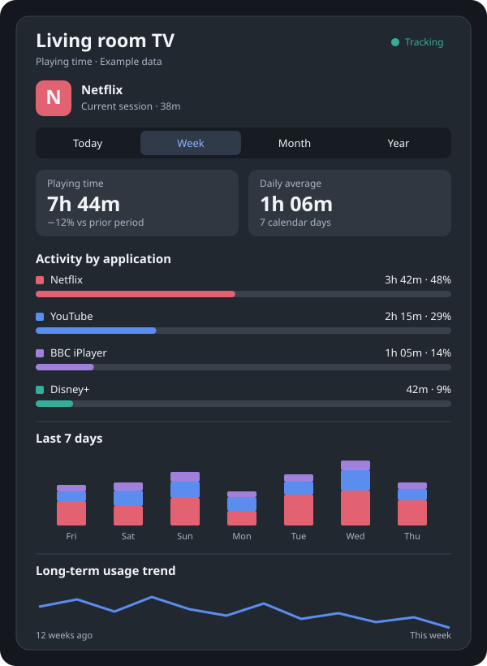

# Media Activity Card

Local analytics for [Media Activity Tracker](https://github.com/thomtom24/HA-Media-Activity-Tracker), one card per media player.

## Preview



Design illustration; not a screenshot of a live Home Assistant installation.

## Install
Install the tracker first. In HACS add this repository as a Dashboard custom repository and install. Reload the browser and add Media Activity Card through the dashboard UI; select the tracker’s Tracking status sensor. For manual installation copy ha-media-activity-card.js to config/www and register /local/ha-media-activity-card.js as a JavaScript module resource.

## Features
Live state and app, current session, today/week/month/year views, comparison with the previous period, app breakdown, stacked daily charts for the last seven days and selected week/month, rolling 30/90/365-day trends, weekday and time-of-day heatmaps, insights, configurable sections, optional daily activity target, full statistics dialog and CSV export (up to ten years). Uses native theme variables and responds to card width. Data comes from the local authenticated tracker API. No analytics or external assets.

## Example
```yaml
type: custom:media-activity-card
entity: sensor.example_tracking_status
period: day
trend: '90'
```

The visual editor also configures individual sections. Reported time is dependent on the selected source and tracking conditions. New installations have no historic data. Calendar-day averages include zero days; see the recorded-since date. The card refreshes every 30 seconds. Initial v0.1.0 candidate; browser and HA testing required.
